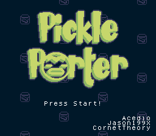
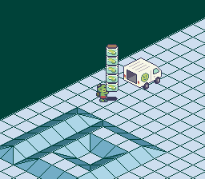

# Pickle Porter

 

Dash, slide, and weave as you balance your stack of pickle jars to the back of
your reliable kappa-truck!

A SNES game created for [SNESDEV 2026](https://itch.io/jam/snesdev-2026).

## Controls

- *D-Pad* - Move
- *A* - Perform a quick dash (mash)

 

## Credits

Font is adapted from Hourglass by [DamienG](https://damieng.com/zx-origins).

The BRR files in asset, except for flug\_02.brr, were authored by [Doug
Fraker](https://github.com/nesdoug/SNES_13). flug\_02.brr is actually
CornetTheory playing his flugelhorn xD

Terrific Audio Driver was authored by
[Marcus Rowe](https://github.com/undisbeliever/terrific-audio-driver).
